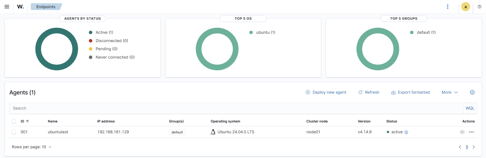
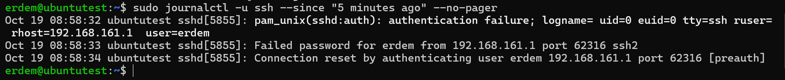
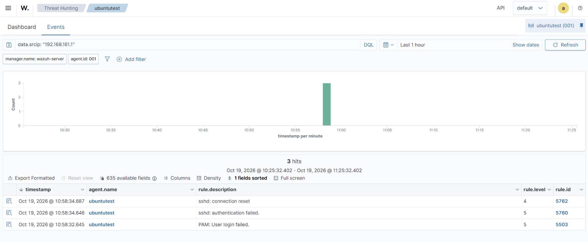
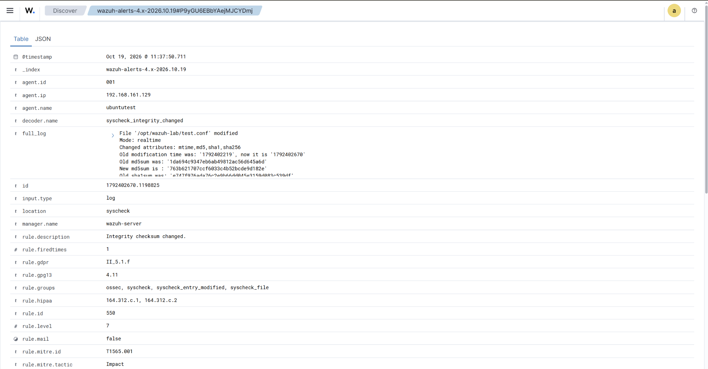
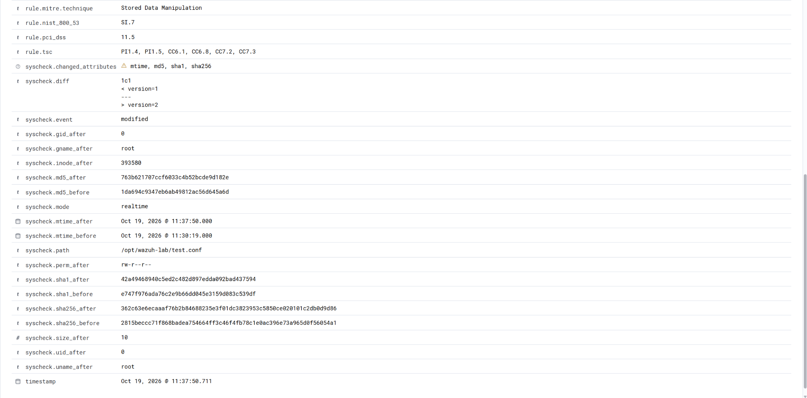
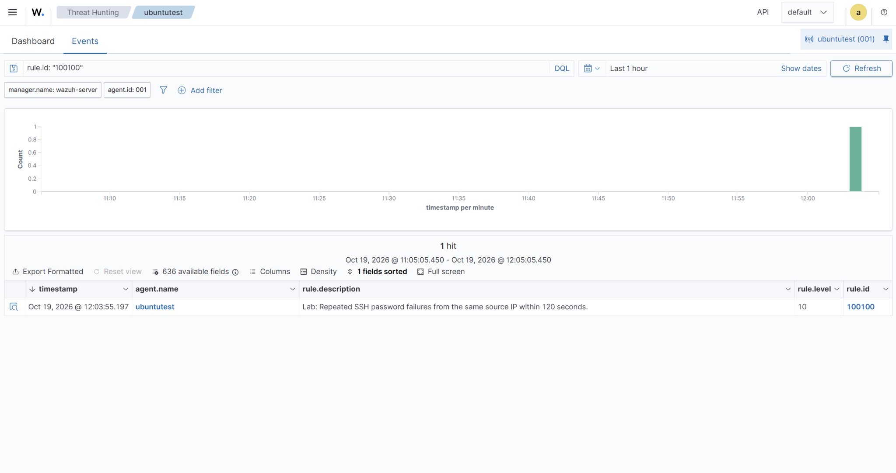
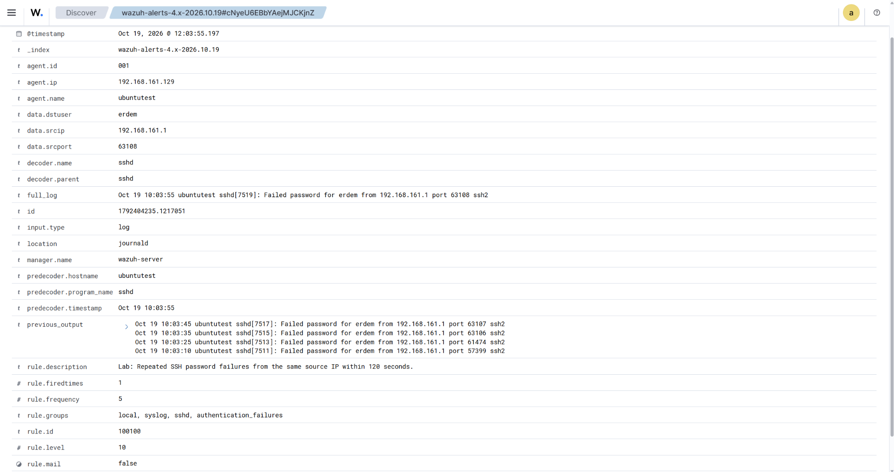

# Wazuh Home Lab

I built this lab to learn how a SIEM collects events and turns them into alerts. I wanted to follow an event from the Linux system where it happened to the Wazuh dashboard, and understand why a rule matched.

I started with a failed SSH login and a file change. Then I added my own SSH correlation rule and a small Python script to retrieve its alerts. Everything here was tested on my own virtual machines.

**Author:** Erdem Yacel · **Test date:** 19 October 2026

## My setup

| Component | Setup | Purpose |
| --- | --- | --- |
| Windows laptop | 16 GB RAM; VMware Workstation Pro | Runs the VMs; used PowerShell for SSH |
| Wazuh server | Wazuh 4.14.9 all-in-one OVA; 4 vCPU, 8 GB RAM, 50 GB disk; `192.168.161.128` | Manager, indexer and dashboard |
| Ubuntu server | Ubuntu 24.04.5 LTS; 2 vCPU, 2 GB RAM, 20 GB disk; `192.168.161.129` | Test endpoint, named `ubuntutest` |
| Wazuh agent | Version 4.14.9; ID `001` | Collects events on Ubuntu |

Both VMs use VMware NAT so they can communicate on the private lab network and download packages. The agent connected to the manager on TCP 1514. The dashboard showed it as active; the following tests confirmed that events were also reaching Wazuh.



## 1. Following a failed SSH login

From Windows, I ran this command and entered one incorrect password:

```powershell
ssh -o PreferredAuthentications=password -o PubkeyAuthentication=no -o NumberOfPasswordPrompts=1 erdem@192.168.161.129
```

I checked the original event on Ubuntu with `sudo journalctl -u ssh --since "5 minutes ago" --no-pager`.



The agent collected the event from journald. Wazuh decoded it as an sshd event and generated rule **5760**, level **5**, for the rejected password. The affected account was `erdem` on `ubuntutest`; the source address was `192.168.161.1`.



One attempt produced three related alerts: PAM failure (`5503`), SSH authentication failure (`5760`), and connection reset (`5762`). I learned to read the underlying records rather than treat each alert as a separate login attempt.

If this were unexpected, I would identify the source system, look for repeated attempts against other accounts, and check for a successful login afterward. A single rejected password does not establish an attack.

## 2. Detecting a file change

I created `/opt/wazuh-lab/test.conf` containing `version=1`. Inside the existing `<syscheck>` section of the Ubuntu agent configuration, I added:

```xml
<directories check_all="yes" realtime="yes" report_changes="yes">/opt/wazuh-lab</directories>
```

I backed up the configuration, checked it with `sudo /var/ossec/bin/wazuh-syscheckd -t`, and restarted the agent. Its log confirmed that the initial scan had finished and real-time monitoring had started. I then changed the file:

```bash
echo 'version=2' | sudo tee /opt/wazuh-lab/test.conf
```



Wazuh generated rule **550**, level **7**, with the description `Integrity checksum changed.` It reported changed modification time and content hashes, and showed the exact text difference:



Both versions were 10 bytes including the newline, so the change was detected even though the file size stayed the same. The reported owner was `root`, but ownership does not identify who edited the file. For an unexplained change, I would check whether it was authorized and correlate sudo or audit records. I did not enable who-data attribution in this lab.

## 3. Writing and testing a detection rule

I added [rule 100100](rules/ssh-correlation.xml) to the manager's `/var/ossec/etc/rules/local_rules.xml`, keeping the existing example rule. It looks for **five SSH password failures from the same source IP within 120 seconds**, on the same agent by default. It correlates rule `5760`, so the related PAM and connection-reset records are not counted as extra password failures. It does not require the target username to stay the same.

I validated the configuration with `sudo /var/ossec/bin/wazuh-analysisd -t`. In one `wazuh-logtest` session, the first four sample events matched `5760`; the fifth matched my rule `100100` at level **10**.

After restarting `wazuh-manager`, I made five real SSH attempts with incorrect passwords. The dashboard showed the custom alert:



The alert's `previous_output` contained four failures at **10:03:10, 10:03:25, 10:03:35 and 10:03:45 UTC**. The current event was at **10:03:55 UTC**: five failures in **45 seconds**. Source: `192.168.161.1`; target account: `erdem`; endpoint: `ubuntutest`.



This was an intentional test. In a real investigation, I would check whether the source was expected, how widely it was trying accounts, and whether any attempt succeeded. The higher rule level is a prioritization choice, not proof of compromise.

## 4. Retrieving alerts with Python

I wrote [fetch_alerts.py](scripts/fetch_alerts.py) using Python's standard library. It queries the **Wazuh Indexer API**, filters for agent `001` and rule `100100`, prints a short summary, and saves the returned alerts to JSON. This automates a small reporting task I had previously done in the dashboard.

I ran it on the Wazuh server because the indexer listens on `127.0.0.1:9200`. Its certificate includes that IP. The script verifies the certificate using the lab CA, asks for the password with `getpass`, and does not save credentials. It has a 20-second timeout and rejects searches reporting timeouts or failed shards.

To run it on this lab server, put the script in `~/wazuh-lab`, then:

```bash
sudo install -m 644 /etc/wazuh-indexer/certs/root-ca.pem ~/wazuh-lab/root-ca.pem
cd ~/wazuh-lab
python3 fetch_alerts.py
```

The CA certificate is public; private keys are not needed. Neither certificates nor credentials are included in this repository.

My run retrieved **one alert**, matching the dashboard's timestamp, endpoint, source, rule and level. The [terminal output](evidence/python-run.txt) is included as a text transcript. The complete JSON report was saved on my VM; it is not included here.

The script retrieves the latest **100** matches across all available alert indices and overwrites `ssh_alert_report.json` each run. It is run manually, not scheduled. I tested it with the lab admin account; a dedicated read-only account would be a useful next improvement.

## What I learned

- An active agent is only the first check; generating an event and finding its alert verifies collection and detection together.
- Alert counts and login-attempt counts can be different.
- Correlation rules add context by connecting several events over time.
- File ownership and MITRE mappings do not, on their own, establish an actor or malicious intent.
- A small script can turn a manual investigation query into a repeatable report.

I also had to troubleshoot a full root filesystem: the virtual disk was 50 GB but the root partition was only 25 GB. After checking the layout, I expanded the partition and XFS filesystem; free space increased to about 25 GB. The OVA also needed Wazuh's documented VMware AMD boot workaround on my Ryzen laptop.

Ubuntu records used UTC while the dashboard displayed UTC+2. For example, the custom alarm at `10:03:55.197 UTC` appeared as `12:03:55.197` in the dashboard.

## Scope

This is a single-endpoint student lab. I tested log collection, alert investigation, FIM, one custom correlation rule, and Python alert reporting. I have not tested production scale, automatic blocking, or scheduled reporting. The seven screenshots are original captures from these tests.

## References

- [Wazuh virtual machine deployment](https://documentation.wazuh.com/current/deployment-options/virtual-machine/virtual-machine.html)
- [Custom rules](https://documentation.wazuh.com/current/user-manual/ruleset/rules/custom.html)
- [File integrity monitoring](https://documentation.wazuh.com/current/user-manual/capabilities/file-integrity/basic-settings.html)
- [Indexer API examples](https://documentation.wazuh.com/current/user-manual/indexer-api/getting-started.html)
